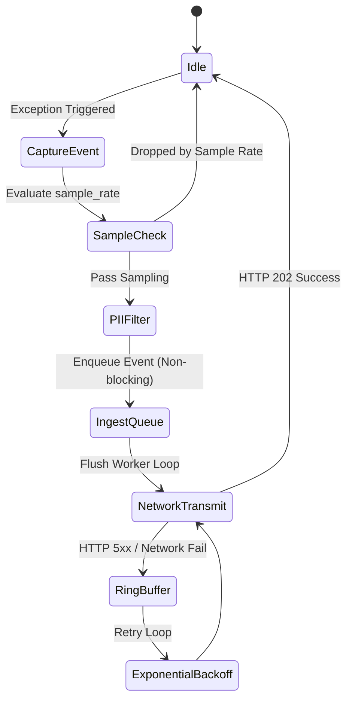

# Sentinel Client SDK Specification & Protocol Guide

**Version**: `1.0.0`  
**Status**: Active Standard  
**Target Audience**: SDK Authors, Open Source Contributors, Architecture Reviewers  
**Source Contract**: [`packages/proto/error_event.proto`](file:///home/fitrapujo/oss/sentinel/packages/proto/error_event.proto)

---

## 1. Overview & Core Philosophy

Sentinel SDKs are lightweight client libraries that capture runtime errors, unhandled exceptions, and diagnostic context from application code and stream them to `ingestor-go`.

### Core Engineering Principles

1. **Zero Impact on Application Performance**: Error capture operations MUST execute asynchronously off the main application looper/thread. An error in Sentinel SDK networking or buffer logic MUST NEVER crash the parent application.
2. **Strict Contract Compliance**: Every SDK MUST serialize events into the exact JSON schema defined by `packages/proto/error_event.proto`.
3. **Client-Side PII Protection**: Sensitive data (tokens, passwords, API keys) MUST be sanitized on the client side before leaving the host environment.
4. **Resilience & Eventual Consistency**: SDKs MUST handle network partition gracefully using bounded in-memory ring buffers and exponential backoff retries.

---

## 2. Configuration Standard

Every Sentinel SDK MUST accept a configuration object or builder pattern with the following standard parameters:

| Parameter | Type | Required | Default | Description |
|:---|:---|:---|:---|:---|
| `api_key` | `string` | **Yes** | — | The SECRET credential (`sent_live_...` or `sent_org_...`). Sent as the `X-API-Key` header ONLY — never in the body. In the Go SDK this is `Config.APIKey`. |
| `project_key` | `string` | Conditional | — | Target project's **unique name** (`projects.name`) — an identifier, NOT a secret. Optional for a project-scoped key (the credential already fixes the project; a mismatch is rejected with 403). **Required** for an organization-wide key, unless supplied as the `X-Project-Key` header, which takes precedence. **Not required in the body** when the key is project-scoped or `X-Project-Key` is set — the JS SDK (`packages/sdk-js`) never puts it in the body and sends the header instead. |
| `endpoint` | `string` | **Yes** | — | Ingestor URL (e.g., `https://sentinel.internal/ingest`). |
| `environment` | `string` | **Yes** | `"production"` | Environment tag (`production`, `staging`, `development`) matching `^[a-z0-9][a-z0-9._-]{0,49}$` — the widened pattern of `sentinel-project-environments` (§3), no longer bare alphanumeric. |
| `release_version` | `string` | No | `""` | Application version tag (`v1.2.0`) used for automated regression detection. Symbolication of browser stack traces requires it **and** `stacktrace[].column`: the processor looks a frame's source map up by the exact `release_version` the event carries (byte for byte the string CI uploaded the maps under — no trimming, no `v` stripping) and resolves it at `line:column`; an event without either is stored with its raw frames. |
| `platform` | `string` | **Yes** | — | Lowercase platform identifier (`golang`, `javascript`, `python`, `rust`, `java`) matching `^[a-z0-9]+$`, at most 50 characters. The JS SDK sends `javascript` from every runtime (browser, node, edge) and carries the runtime in `metadata.runtime`. |
| `sample_rate` | `float` | No | `1.0` | Event sampling ratio (`0.0` to `1.0`). |
| `max_buffer_size` | `int` | No | `100` | Maximum number of events buffered during network outages. |
| `max_breadcrumbs` | `int` | No | `50` | Maximum diagnostic breadcrumbs retained in memory. **Unimplemented in the JS SDK** (`packages/sdk-js` has no breadcrumbs — the wire has no field for them). |
| `debug` | `bool` | No | `false` | Enable SDK internal diagnostic logging to stdout. |

---

## 3. Data Contract & Payload Specification

SDKs MUST construct a JSON HTTP POST body matching `sentinel.v1.ErrorEvent`:

```json
{
  "project_key": "proj_abc123",
  "platform": "golang",
  "environment": "production",
  "release_version": "v1.4.2",
  "error_class": "NilPointerReference",
  "message": "runtime error: invalid memory address",
  "trace_id": "4bf92f3577b34da6a3ce929d0e0e4736",
  "span_id": "00f067aa0ba902b7",
  "timestamp": "2026-07-25T14:00:00Z",
  "stacktrace": [
    {
      "file": "service/user.go",
      "line": 42,
      "function": "GetUserProfile",
      "in_app": true
    },
    {
      "file": "https://app.example.com/assets/index-3f2a1c.js",
      "line": 1,
      "column": 1234,
      "function": "onClick",
      "in_app": true
    }
  ],
  "metadata": {
    "http_method": "GET",
    "http_url": "/api/users/99",
    "user_id": "usr_7712"
  }
}
```

### Protocol Validation Constraints

- **`project_key`**: 1–64 characters. Resolved against `projects.name` **within the authenticated key's organization only** — a name belonging to another organization is 403, never a cross-tenant write.
- **`platform`**: Matches `^[a-z0-9]+$` (lowercase alphanumeric), maximum 50 characters.
- **`environment`**: Matches `^[a-z0-9][a-z0-9._-]{0,49}$` (`sentinel-project-environments` — lowercase alphanumeric first character, then `.`, `_` and `-` allowed, at most 50 characters).
- **`message`**: Maximum 10,000 **bytes** — an oversized message is **rejected** with `400`, not truncated (the validator's `len()` counts bytes, so a multi-byte message hits the cap earlier than its character count suggests). The SDK truncates client-side on a code-point boundary and records the cut (the JS SDK in `metadata.truncated`).
- **`stacktrace`**: Maximum 100 frames. File paths maximum 512 bytes, `function` 255 bytes, `error_class` 255 bytes — the same bytes-not-characters rule as `message`, and the same client-side truncation.
- **`stacktrace[].column`**: Optional integer, **1-based as browsers print it** (V8, SpiderMonkey and JavaScriptCore stack strings are `file:line:column`, 1-based — pass the number through unchanged). Omit it, or send `0`, when the platform has no column (Go, Python, Java frames); `0` means "unknown" and the frame is stored as-is. A negative value is rejected with `400` and `field: stacktrace[i].column`. Symbolication (§8) needs it: a frame without a column is stored raw. The JS SDK passes the engine's number through unchanged and **omits** the key when the engine printed none (never an explicit `0`, never `null`).
- **`metadata`**: Maximum 64 KB total serialized size, **as the validator re-serialises it** (Go's `json.Marshal` escapes `<`, `>`, `&`, U+2028 and U+2029, so a client counting `JSON.stringify` bytes under-counts by up to 5 bytes per such character).
- **`timestamp`**: Optional, RFC 3339 (fractional seconds and any offset accepted; stored as the same instant in UTC). The JS SDK **always sends one** (`new Date().toISOString()` at capture) and **ignores the echo** below — it reads only `errors[]` from the batch response, so a skewed browser clock is corrected server-side with nothing for the client to do. When absent, `null`, or the zero `0001-01-01T00:00:00Z`, the server **defaults it to its own receipt time** (`reason="empty"`). A value more than **60 s ahead** of receipt time (`MaxFutureSkew`, `reason="future"`) or more than **30 days behind** it (`MaxEventAge`, `reason="ancient"`) is **replaced with the receipt time** — never rejected. Every replacement is counted in `sentinel_ingest_timestamp_replaced_total{reason}`; the value the client sent is **not stored** anywhere — it survives only in the ingestor's log line. The effective value is echoed back as `timestamp` in the `202` body (and per `event_ids[]` item on `/ingest/batch`), so a client can diff what it sent against what was used. A `timestamp` that does not parse as RFC 3339 is still `400 Invalid JSON payload`.

---

## 4. HTTP Transport & Ingestion Handshake

- **HTTP Method**: `POST`
- **Path**: `/ingest`
- **Headers**:
  - `Content-Type: application/json`
  - `X-API-Key: <api_key>` — the SECRET (`sent_live_...` project-scoped, or `sent_org_...` organization-wide). Never place it in the body.
  - `X-Project-Key: <project_name>` — optional; for organization-wide keys, selects the target project. **Takes precedence over the body's `project_key`**, so the server resolves tenancy without reading the body.
- **Expected Status**: `HTTP 202 Accepted` (`{"status": "accepted", "event_id": "<effective event id>", "timestamp": "<effective timestamp, RFC 3339 with nanoseconds, UTC>"}`) — both keys are the values the server **used**, which differ from what was sent when the server generated the `event_id` or replaced the `timestamp` (§3).

---

## 5. Security & PII Sanitization Rules

SDKs MUST execute client-side PII scrubbing on `metadata` before HTTP payload transmission.

### Mandatory Masking Keys
Any metadata key matching the following case-insensitive patterns MUST be replaced with `"[FILTERED]"`:
- `password`, `pass`, `passwd`
- `authorization`, `auth`, `token`, `bearer`
- `api_key`, `apikey`, `secret`
- `credit_card`, `card_number`, `cvv`
- `ssn`, `social_security`

---

## 6. Asynchronous Buffer & Retry Mechanism



1. **Queue Architecture**: Enqueue events into a bounded thread-safe ring buffer.
2. **Drop Policy**: If the ring buffer exceeds `max_buffer_size`, drop the oldest events first (FIFO drop).
3. **Retry Strategy**:
   - Retry on HTTP 5xx errors or network socket timeouts.
   - Initial backoff: `1 second`. Exponential multiplier: `2x`. Jitter: `±20%`. Max backoff: `60 seconds`.
   - DO NOT retry on HTTP 4xx (Client Error / Invalid Payload).

---

## 7. Graceful Shutdown & Uncaught Handlers

- **Uncaught Exception Hook**: SDKs MUST hook into platform-native crash handlers (e.g. `process.on('uncaughtException')` in Node.js, `sys.excepthook` in Python, Panic recovery in Go middleware).
- **Flush on Exit**: SDKs MUST expose a blocking `Flush(timeoutMs)` method allowing host applications to drain pending events during graceful shutdown (`SIGTERM`, `SIGINT`).

---

## 8. Sourcemaps — uploading a release's maps from CI

Browser stack traces arrive minified. The processor rewrites each frame to its original
`file:function:line:column` **only** when the map for that frame is already stored under the
event's `release_version` (§2 above), so the upload is a step of the deploy pipeline, not of the
SDK. It is a `multipart/form-data` `POST /api/sourcemaps` on the **dashboard** host (not the
ingestor), authenticated by the same `X-API-Key` that ingests the events — a key whose scope is
`ingest` or `admin`; a `report`, `read` or `agent` key is `403 forbidden_scope`. An
organization-wide key (`sent_org_…`) names its project in `X-Project-Key: <project name>`, exactly
as on `/ingest`.

Two rules a pipeline must honour, and both are load-bearing:

1. **Upload BEFORE the deploy switches traffic.** An event that arrives before its map is stored is
   symbolicated with whatever is there — nothing — and is **not** re-symbolicated later; its
   fingerprint is computed on the raw frames and it lands on a different issue than the same crash
   after the upload.
2. **`release_version` must be the exact string the SDK sends on events**, byte for byte. The route
   normalises nothing — no `v` stripping, no case folding, **and no trimming**: a value with a
   leading space or a trailing newline (the shell `$(…)` classic) is `400 invalid_request` with
   `details { "field": "release_version", "reason": "whitespace" }`, so the stored string is exactly
   what you sent and exactly what the SDK must send.

### The CLI

`packages/sdk-js` ships the upload as a command, `sentinel-sourcemaps` (`bin` of `@sentinel/sdk-js`,
node ≥ 20, no runtime dependencies), which is the tool the loop below was a placeholder for:

```sh
sentinel-sourcemaps upload <build dir> <public prefix> [options]
  --release <string>        release_version, VERBATIM (env SENTINEL_RELEASE)      required
  --dashboard-url <url>     https://sentinel.daya.ai (env SENTINEL_DASHBOARD_URL) required
  --api-key <string>        (env SENTINEL_API_KEY)                                required
  --project-key <string>    X-Project-Key for an org-wide key (env SENTINEL_PROJECT_KEY)
  --delete                  delete each uploaded *.js.map / *.mjs.map after ITS batch succeeded
  --batch-size <n>          default 50 (the route's per-request file cap); outside [1, 50] → clamped, one warn;
                            non-numeric → exit 2; ≤ 100 MiB serialised per request regardless
  --dry-run                 print the pairs and exit 0 without posting
  --json                    one JSON object per file on stdout
```

- **Pairing.** Every `*.js` / `*.mjs` under `<build dir>` whose trailing `//# sourceMappingURL=`
  comment names a map that exists is uploaded under `<public prefix>/<the chunk's relative path>`;
  a map no chunk references falls back to the name-based rule (`<relative path without .map>`).
  The comment rule is what makes a **Turbopack** build symbolicate — Turbopack names a client
  chunk's map by a different hash than the chunk (`d69eb7d85499027c.js` carries
  `//# sourceMappingURL=8f15d5d03090a0be.js.map`), so the name-based loop below stores paths no
  browser frame ever carries. Webpack writes `<chunk>.js.map` beside `<chunk>.js`, and the two
  rules agree there. An **index map** (a `sections` map with no string `mappings` — Turbopack
  emits one per server entry stub) is skipped with one `warn` per file, because the route stores
  flat maps only and answers `422 invalid_sourcemap` for one.
- **Batches** of ≤ 50 files **and** ≤ 100 MiB serialised per request (multipart overhead
  included — the dashboard host's `BODY_SIZE_LIMIT` is 110M and a breach is the adapter's
  plain-text `413`, not the envelope); a single map over the budget goes alone in its own request.
- **Exit codes.** `0` when every batch was 2xx; `1` on any 4xx — the envelope's `code`, `message`
  and `details` are printed, later batches are not sent, earlier ones stay stored and nothing is
  deleted — or on a 5xx / network failure after 4 attempts (2 s / 4 s / 8 s); `2` for a usage
  error before any request: a missing or empty option, an **empty `--release`**, a release with
  leading or trailing whitespace (the `$(…)` newline — the CLI refuses rather than trims,
  mirroring the route's `reason: "whitespace"`), a non-numeric `--batch-size`, an unreadable
  directory, zero maps. Every 5xx and every network failure is one retry-then-fail class whatever
  the body; the envelope `code` is printed, never branched on.
- **Output.** One line per file — `<outcome>  <minified_path as stored>  <sha256[:12]>  <size>` —
  from the response's `files[]`, so a script can diff sent vs stored; `--json` prints the same as
  objects. The key is never printed. On a connection failure the CLI prints the *Reachability*
  rule below.
- **`--delete`** removes a batch's `.js.map` / `.mjs.map` files only after that batch's 2xx and
  touches nothing it did not upload — a `.css.map` stays; sweeping every `*.map` out of a Next
  output is the wrapper's job (next section).

The same function the CLI wraps, `uploadSourcemaps()`, is what `withSentinelConfig` calls
in-process; see the package README for the full reference.

### Next.js: `withSentinelConfig`

A Next.js app does not run the CLI: it wraps `next.config.mjs` and the upload happens **inside
`next build`**, under Turbopack and webpack alike, before Next's standalone copy and before any
Sentry `deleteSourcemapsAfterUpload` step.

```js
import { withSentinelConfig } from '@sentinel/sdk-js/nextjs/config';
export default withSentinelConfig(nextConfig, {
  release,                                     // MUST equal init.release, unique per build when uploads are on
  sourcemaps: {
    upload: process.env.SENTINEL_UPLOAD_SOURCEMAPS === 'false' ? false : undefined,  // tri-state
    dashboardUrl: process.env.SENTINEL_DASHBOARD_URL,
    apiKey: process.env.SENTINEL_API_KEY,
    projectKey: process.env.SENTINEL_PROJECT_KEY,
    deleteAfterUpload: true,
    publicPrefix: '/_next/static',             // default, assetPrefix / basePath aware
    serverRoot: '/app/.next/server',           // the container's runtime path of .next/server
  },
});
```

- **Two walks, two batch series.** The wrapper sets `productionBrowserSourceMaps: true` and
  `experimental.serverSourceMaps: true`, then in `compiler.runAfterProductionCompile` runs the
  **browser walk** — `.next/static/**` under `(assetPrefix ?? '') + (basePath ?? '') + '/_next/static'`,
  which is the path a browser frame's `file` carries after the route strips scheme and host — and
  the **server walk** — `.next/server/**` under `serverRoot`, so a map is stored under the
  **absolute filesystem path** the node runtime prints in a server frame (`/app/.next/server/app/page.js`).
  `serverRoot` must therefore equal the container's runtime path of `.next/server`; read it off one
  stored node frame (`metadata.runtime = "node"`, the raw `file`). The two series are
  independent: the server walk runs whether or not the browser series failed, and a `warn` names
  its series.
- **Then every `*.map`** under both trees is deleted (the `.css.map` files Next also emits
  included) when `deleteAfterUpload` — the standalone image never carries one — and, because
  webpack's compile-time `*.nft.json` traces list those maps, the traces are rewritten without
  them so the standalone copy stays green.
- **Failure policy.** Any 4xx (`401`, `403`, `400`, `413`, `422 release_full`) **fails the
  build**, nothing is deleted, a series already stored stays stored; a 5xx / network failure with
  the retries exhausted is **one `warn` per series, the maps are deleted anyway and the build
  continues** — the release then never symbolicates for that series (recover by rebuilding under
  the same `release`; identical bytes re-upload as `unchanged`). `upload` **explicitly `true`**
  with `dashboardUrl` / `apiKey` unresolved, an empty or whitespace-padded `release` with uploads
  on, and a walk that finds zero `*.js.map` all fail the build before anything is uploaded.
- **Caps.** ≤ 50 files and ≤ 100 MiB serialised per request, ≤ 50 MiB per map
  (`SOURCEMAP_MAX_BYTES`), and **`SOURCEMAP_MAX_FILES_PER_RELEASE`** maps per release — 2 000 by
  default since `sentinel-sourcemaps-turbopack-grouping`; a Next app's server maps count against it
  (a Turbopack build of `web` holds ≈ 1 240 maps per release, so a `web` release fits with room),
  and the `SOURCEMAP_MAX_FILES_PER_RELEASE + 1`th file is `422 release_full`, a red build.
- **What the processor does with a server frame.** A symbolicated frame's `in_app` is set by the
  processor from the original path — `/node_modules/` and Turbopack's `[turbopack]` / `[next]` /
  `[externals]` namespaces are not in-app, everything under `[project]` is — and the value the SDK
  sent is kept beside it under `raw.in_app`. An unsymbolicated Turbopack server chunk
  (`_052cc036._.js`, `node_modules__pnpm_52f51f25._.js`) groups by its `_<8-hex>`-stripped name
  (`_*._.js`, `node_modules__pnpm_*._.js`), so such a frame is one issue across builds rather than
  a new one per build (since `sentinel-sourcemaps-turbopack-grouping`).
- **With `@sentry/nextjs`** and its `deleteSourcemapsAfterUpload` on, the only valid order is
  `withSentryConfig(withSentinelConfig(nextConfig, …), sentryOptions)` — the inner hook runs
  first, so Sentinel uploads and deletes before Sentry's step looks.

### No node available? The `curl`

```sh
# 1. Upload BEFORE the deploy switches traffic — events that arrive first are not re-symbolicated.
# 2. release_version must be the exact string the SDK sends on events.
curl -sS -X POST "https://<dashboard host>/api/sourcemaps" \
  -H "X-API-Key: $SENTINEL_INGEST_KEY" \
  -F "release_version=$RELEASE_VERSION" \
  -F "minified_path=/assets/index-3f2a1c.js" -F "file=@dist/assets/index-3f2a1c.js.map" \
  -F "minified_path=/assets/vendor-9a0d4e.js" -F "file=@dist/assets/vendor-9a0d4e.js.map"
```

`minified_path` and `file` parts are paired **by position** — the i-th `file` is the i-th
`minified_path` — and the counts must match. `minified_path` is the path of the **generated** file
as the browser will report it in `stacktrace[].file`: an `http(s)://` URL is accepted and stored
with its scheme and host dropped and any `?…` / `#…` stripped (`https://app.example.com/assets/x.js?v=1`
→ `/assets/x.js`); every other form (`webpack://…`, a bare `/assets/x.js`) is stored byte-identically
apart from the `?…` / `#…` strip. The response echoes the stored path per file, so a script can diff
what it sent against what was stored. Two parts that normalise to the same
path in one request are refused whole. The route never derives the path from the map's own `file`
key, which is a basename and collides across directories.

Re-running the identical upload is safe (`200`, every file `unchanged`); re-uploading a rebuilt
bundle under the same version **replaces** the previous map (`201`, `replaced`). Every failure is
`{ "error": { "code", "message", "details" } }` with a non-2xx status; `4xx` means fix the script
and do not retry, `503 storage_unavailable` means retry later, `413 payload_too_large` means split
the request (a file is over `SOURCEMAP_MAX_BYTES`, 50 MiB, or the whole body is over the host's
`BODY_SIZE_LIMIT`). Caps: 50 files per request, `SOURCEMAP_MAX_FILES_PER_RELEASE` per release
(2 000 by default since `sentinel-sourcemaps-turbopack-grouping`).

### A loop over a build directory

Takes the build directory and the public prefix as **arguments** because build tools do not agree
on where maps land: Vite emits under `dist/assets/`, Next.js under `.next/static/chunks/**` (served
as `/_next/static/chunks/…`) and never `dist/`.

```sh
#!/bin/sh
# usage: upload-sourcemaps.sh <build dir> <public prefix> — e.g. `dist /` or `.next/static /_next/static`
set -eu
build_dir="$1"; prefix="${2%/}"
args=""
for map in $(find "$build_dir" -type f -name '*.js.map'); do
  rel="${map#"$build_dir"/}"                      # assets/index-3f2a1c.js.map
  args="$args -F minified_path=$prefix/${rel%.map} -F file=@$map"
done
[ -n "$args" ] || { echo "no *.js.map under $build_dir" >&2; exit 1; }
# shellcheck disable=SC2086 — $args is a deliberately word-split list of -F pairs
curl -sS --fail-with-body -X POST "https://<dashboard host>/api/sourcemaps" \
  -H "X-API-Key: $SENTINEL_INGEST_KEY" -F "release_version=$RELEASE_VERSION" $args
```

Split the loop into batches of at most 50 maps if a build emits more than that. If the build step
that follows deletes maps from the output (a Sentry `deleteSourcemapsAfterUpload`, for instance),
run this **before** it. The loop pairs by name only, so it does not work for a Turbopack build
(*The CLI*, above); it is the fallback for a pipeline with no node, not the recommended path.

### Reachability

The dashboard host resolves to the **internal** ELB (`deploy/helm/sentinel/values-huawei-*.yml:
dashboard.ingress.elbId`, the shared internal load balancer), so uploads must run from the
**self-hosted runner pool** (the pool `.github/workflows/ci.yml` already runs on) **or from the
VPN** — a GitHub-hosted runner cannot reach it, and a pipeline that tries sees a connection
timeout, not a `4xx`.

---

## 9. Directory Placement

New SDK implementations MUST be placed in dedicated subdirectories under `packages/`:

- `packages/sdk-go/` — Official Go SDK
- [`packages/sdk-js/`](../packages/sdk-js/README.md) — Official JavaScript/TypeScript SDK (`@sentinel/sdk-js`, **exists**): browser, node and edge entries, the Next.js adapter, the tunnel route, the `sentinel-sourcemaps` CLI and the `withSentinelConfig` build wrapper
- `packages/sdk-python/` — Official Python SDK
