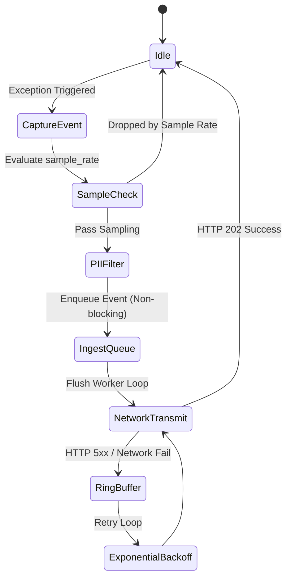

# Sentinel Client SDK Specification & Protocol Guide

**Version**: `1.0.0`  
**Status**: Active Standard  
**Target Audience**: SDK Authors, Open Source Contributors, Architecture Reviewers  
**Source Contract**: [`packages/proto/error_event.proto`](file:///home/fitrapujo/oss/sentinel/packages/proto/error_event.proto)

---

## 1. Overview & Core Philosophy

Sentinel SDKs are lightweight client libraries that capture runtime errors, unhandled exceptions, and diagnostic context from application code and stream them to `ingestor-go`.

### Core Engineering Principles

1. **Zero Impact on Application Performance**: Error capture operations MUST execute asynchronously off the main application looper/thread. An error in Sentinel SDK networking or buffer logic MUST NEVER crash the parent application.
2. **Strict Contract Compliance**: Every SDK MUST serialize events into the exact JSON schema defined by `packages/proto/error_event.proto`.
3. **Client-Side PII Protection**: Sensitive data (tokens, passwords, API keys) MUST be sanitized on the client side before leaving the host environment.
4. **Resilience & Eventual Consistency**: SDKs MUST handle network partition gracefully using bounded in-memory ring buffers and exponential backoff retries.

---

## 2. Configuration Standard

Every Sentinel SDK MUST accept a configuration object or builder pattern with the following standard parameters:

| Parameter | Type | Required | Default | Description |
|:---|:---|:---|:---|:---|
| `api_key` | `string` | **Yes** | — | The SECRET credential (`sent_live_...` or `sent_org_...`). Sent as the `X-API-Key` header ONLY — never in the body. In the Go SDK this is `Config.APIKey`. |
| `project_key` | `string` | Conditional | — | Target project's **unique name** (`projects.name`) — an identifier, NOT a secret. Optional for a project-scoped key (the credential already fixes the project; a mismatch is rejected with 403). **Required** for an organization-wide key, unless supplied as the `X-Project-Key` header, which takes precedence. |
| `endpoint` | `string` | **Yes** | — | Ingestor URL (e.g., `https://sentinel.internal/ingest`). |
| `environment` | `string` | **Yes** | `"production"` | Lowercase alphanumeric environment tag (`production`, `staging`, `development`). |
| `release_version` | `string` | No | `""` | Application version tag (`v1.2.0`) used for automated regression detection. Symbolication of browser stack traces requires it **and** `stacktrace[].column`: the processor looks a frame's source map up by the exact `release_version` the event carries (byte for byte the string CI uploaded the maps under — no trimming, no `v` stripping) and resolves it at `line:column`; an event without either is stored with its raw frames. |
| `platform` | `string` | **Yes** | — | Lowercase platform identifier (`golang`, `javascript`, `python`, `rust`, `java`). |
| `sample_rate` | `float` | No | `1.0` | Event sampling ratio (`0.0` to `1.0`). |
| `max_buffer_size` | `int` | No | `100` | Maximum number of events buffered during network outages. |
| `max_breadcrumbs` | `int` | No | `50` | Maximum diagnostic breadcrumbs retained in memory. |
| `debug` | `bool` | No | `false` | Enable SDK internal diagnostic logging to stdout. |

---

## 3. Data Contract & Payload Specification

SDKs MUST construct a JSON HTTP POST body matching `sentinel.v1.ErrorEvent`:

```json
{
  "project_key": "proj_abc123",
  "platform": "golang",
  "environment": "production",
  "release_version": "v1.4.2",
  "error_class": "NilPointerReference",
  "message": "runtime error: invalid memory address",
  "trace_id": "4bf92f3577b34da6a3ce929d0e0e4736",
  "span_id": "00f067aa0ba902b7",
  "timestamp": "2026-07-25T14:00:00Z",
  "stacktrace": [
    {
      "file": "service/user.go",
      "line": 42,
      "function": "GetUserProfile",
      "in_app": true
    },
    {
      "file": "https://app.example.com/assets/index-3f2a1c.js",
      "line": 1,
      "column": 1234,
      "function": "onClick",
      "in_app": true
    }
  ],
  "metadata": {
    "http_method": "GET",
    "http_url": "/api/users/99",
    "user_id": "usr_7712"
  }
}
```

### Protocol Validation Constraints

- **`project_key`**: 1–64 characters. Resolved against `projects.name` **within the authenticated key's organization only** — a name belonging to another organization is 403, never a cross-tenant write.
- **`platform`**: Matches `^[a-z0-9]+$` (lowercase alphanumeric).
- **`environment`**: Matches `^[a-z0-9]+$` (lowercase alphanumeric).
- **`message`**: Truncated to maximum 10,000 characters.
- **`stacktrace`**: Maximum 100 frames. File paths truncated to 512 characters.
- **`stacktrace[].column`**: Optional integer, **1-based as browsers print it** (V8, SpiderMonkey and JavaScriptCore stack strings are `file:line:column`, 1-based — pass the number through unchanged). Omit it, or send `0`, when the platform has no column (Go, Python, Java frames); `0` means "unknown" and the frame is stored as-is. A negative value is rejected with `400` and `field: stacktrace[i].column`.
- **`metadata`**: Maximum 64 KB total serialized size.

---

## 4. HTTP Transport & Ingestion Handshake

- **HTTP Method**: `POST`
- **Path**: `/ingest`
- **Headers**:
  - `Content-Type: application/json`
  - `X-API-Key: <api_key>` — the SECRET (`sent_live_...` project-scoped, or `sent_org_...` organization-wide). Never place it in the body.
  - `X-Project-Key: <project_name>` — optional; for organization-wide keys, selects the target project. **Takes precedence over the body's `project_key`**, so the server resolves tenancy without reading the body.
- **Expected Status**: `HTTP 202 Accepted` (`{"status": "accepted"}`)

---

## 5. Security & PII Sanitization Rules

SDKs MUST execute client-side PII scrubbing on `metadata` before HTTP payload transmission.

### Mandatory Masking Keys
Any metadata key matching the following case-insensitive patterns MUST be replaced with `"[FILTERED]"`:
- `password`, `pass`, `passwd`
- `authorization`, `auth`, `token`, `bearer`
- `api_key`, `apikey`, `secret`
- `credit_card`, `card_number`, `cvv`
- `ssn`, `social_security`

---

## 6. Asynchronous Buffer & Retry Mechanism



1. **Queue Architecture**: Enqueue events into a bounded thread-safe ring buffer.
2. **Drop Policy**: If the ring buffer exceeds `max_buffer_size`, drop the oldest events first (FIFO drop).
3. **Retry Strategy**:
   - Retry on HTTP 5xx errors or network socket timeouts.
   - Initial backoff: `1 second`. Exponential multiplier: `2x`. Jitter: `±20%`. Max backoff: `60 seconds`.
   - DO NOT retry on HTTP 4xx (Client Error / Invalid Payload).

---

## 7. Graceful Shutdown & Uncaught Handlers

- **Uncaught Exception Hook**: SDKs MUST hook into platform-native crash handlers (e.g. `process.on('uncaughtException')` in Node.js, `sys.excepthook` in Python, Panic recovery in Go middleware).
- **Flush on Exit**: SDKs MUST expose a blocking `Flush(timeoutMs)` method allowing host applications to drain pending events during graceful shutdown (`SIGTERM`, `SIGINT`).

---

## 8. Sourcemaps — uploading a release's maps from CI

Browser stack traces arrive minified. The processor rewrites each frame to its original
`file:function:line:column` **only** when the map for that frame is already stored under the
event's `release_version` (§2 above), so the upload is a step of the deploy pipeline, not of the
SDK. It is a `multipart/form-data` `POST /api/sourcemaps` on the **dashboard** host (not the
ingestor), authenticated by the same `X-API-Key` that ingests the events — a key whose scope is
`ingest` or `admin`; a `report`, `read` or `agent` key is `403 forbidden_scope`. An
organization-wide key (`sent_org_…`) names its project in `X-Project-Key: <project name>`, exactly
as on `/ingest`.

Two rules a pipeline must honour, and both are load-bearing:

1. **Upload BEFORE the deploy switches traffic.** An event that arrives before its map is stored is
   symbolicated with whatever is there — nothing — and is **not** re-symbolicated later; its
   fingerprint is computed on the raw frames and it lands on a different issue than the same crash
   after the upload.
2. **`release_version` must be the exact string the SDK sends on events**, byte for byte. The route
   normalises nothing — no `v` stripping, no case folding, **and no trimming**: a value with a
   leading space or a trailing newline (the shell `$(…)` classic) is `400 invalid_request` with
   `details { "field": "release_version", "reason": "whitespace" }`, so the stored string is exactly
   what you sent and exactly what the SDK must send.

### The `curl`

```sh
# 1. Upload BEFORE the deploy switches traffic — events that arrive first are not re-symbolicated.
# 2. release_version must be the exact string the SDK sends on events.
curl -sS -X POST "https://<dashboard host>/api/sourcemaps" \
  -H "X-API-Key: $SENTINEL_INGEST_KEY" \
  -F "release_version=$RELEASE_VERSION" \
  -F "minified_path=/assets/index-3f2a1c.js" -F "file=@dist/assets/index-3f2a1c.js.map" \
  -F "minified_path=/assets/vendor-9a0d4e.js" -F "file=@dist/assets/vendor-9a0d4e.js.map"
```

`minified_path` and `file` parts are paired **by position** — the i-th `file` is the i-th
`minified_path` — and the counts must match. `minified_path` is the path of the **generated** file
as the browser will report it in `stacktrace[].file`: an `http(s)://` URL is accepted and stored
with its scheme and host dropped and any `?…` / `#…` stripped (`https://app.example.com/assets/x.js?v=1`
→ `/assets/x.js`); every other form (`webpack://…`, a bare `/assets/x.js`) is stored byte-identically
apart from the `?…` / `#…` strip. The response echoes the stored path per file, so a script can diff
what it sent against what was stored. Two parts that normalise to the same
path in one request are refused whole. The route never derives the path from the map's own `file`
key, which is a basename and collides across directories.

Re-running the identical upload is safe (`200`, every file `unchanged`); re-uploading a rebuilt
bundle under the same version **replaces** the previous map (`201`, `replaced`). Every failure is
`{ "error": { "code", "message", "details" } }` with a non-2xx status; `4xx` means fix the script
and do not retry, `503 storage_unavailable` means retry later, `413 payload_too_large` means split
the request (a file is over `SOURCEMAP_MAX_BYTES`, 50 MiB, or the whole body is over the host's
`BODY_SIZE_LIMIT`). Caps: 50 files per request, 500 per release.

### A loop over a build directory

Takes the build directory and the public prefix as **arguments** because build tools do not agree
on where maps land: Vite emits under `dist/assets/`, Next.js under `.next/static/chunks/**` (served
as `/_next/static/chunks/…`) and never `dist/`.

```sh
#!/bin/sh
# usage: upload-sourcemaps.sh <build dir> <public prefix> — e.g. `dist /` or `.next/static /_next/static`
set -eu
build_dir="$1"; prefix="${2%/}"
args=""
for map in $(find "$build_dir" -type f -name '*.js.map'); do
  rel="${map#"$build_dir"/}"                      # assets/index-3f2a1c.js.map
  args="$args -F minified_path=$prefix/${rel%.map} -F file=@$map"
done
[ -n "$args" ] || { echo "no *.js.map under $build_dir" >&2; exit 1; }
# shellcheck disable=SC2086 — $args is a deliberately word-split list of -F pairs
curl -sS --fail-with-body -X POST "https://<dashboard host>/api/sourcemaps" \
  -H "X-API-Key: $SENTINEL_INGEST_KEY" -F "release_version=$RELEASE_VERSION" $args
```

Split the loop into batches of at most 50 maps if a build emits more than that. If the build step
that follows deletes maps from the output (a Sentry `deleteSourcemapsAfterUpload`, for instance),
run this **before** it.

### Reachability

The dashboard host resolves to the **internal** ELB (`deploy/helm/sentinel/values-huawei-*.yml:
dashboard.ingress.elbId`, the shared internal load balancer), so uploads must run from the
**self-hosted runner pool** (the pool `.github/workflows/ci.yml` already runs on) **or from the
VPN** — a GitHub-hosted runner cannot reach it, and a pipeline that tries sees a connection
timeout, not a `4xx`.

---

## 9. Directory Placement

New SDK implementations MUST be placed in dedicated subdirectories under `packages/`:

- `packages/sdk-go/` — Official Go SDK
- `packages/sdk-js/` — Official JavaScript/TypeScript SDK
- `packages/sdk-python/` — Official Python SDK
